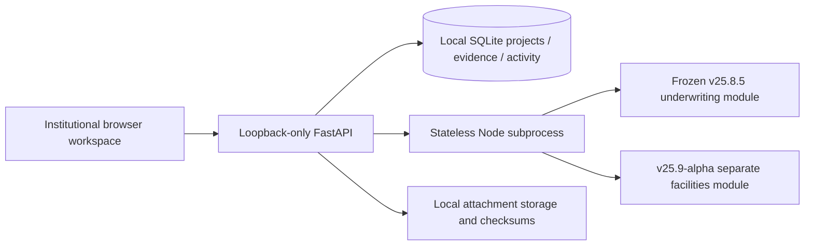

# v26 Architecture and data boundaries

Each `/api/projects/{id}` path scopes its scenarios, stored runs and evidence by project identity. Users may create or update project metadata, create a scenario from defaults, revise input snapshots, calculate a new immutable run, and view/export the monthly ledger. Storage uses real SQLite foreign keys; the app saves the *complete* input JSON as submitted, the scenario version and both financial-engine file hashes. No calculations are performed by UI formatting.

**Financial invariant:** `engine/underwrite25.js` and `engine/facility_waterfall259.js` remain byte-for-byte equal to the frozen v25.9 source. The Node bridge is only an invocation layer. The v25.9 financing path is a separate scenario mode and should not be confused with a credit-model audit.

**Client implementation:** TS compiles with `tsc` to standards-compliant JS. There is no dependency on CDN code or uninstalled npm packages. Because the environment blocks npm access, this is a working non-React web app; componentizing for React/TSX is an explicit future front-end refactor subject to output equivalence tests.

**Storage migration:** Production should replace SQLite with PostgreSQL and local files with a private object store. Apply per-organization authorization to every read and write, use server-side provenance chain validation, and preserve immutable model runs. Merely pointing the local API at a public host is unsafe.

**Operational controls not yet provided:** identity, user roles, corporate SSO, key management, tenancy, live document processing, backups, SOC2 controls, formal application security tests, active deployment, production CI/CD, actual ESAs, executed contracts and third-party lender-model assurance.
